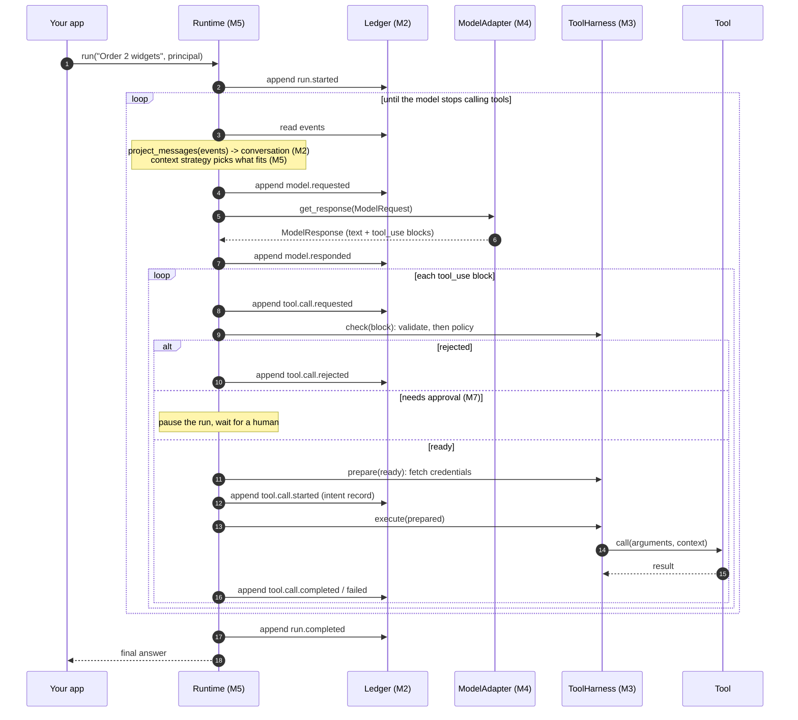

# agentreins internals

How the code works, end to end. For maintainers and contributors: read it to understand, change or extend the core without reverse-engineering it.

| Document | Answers |
|---|---|
| [REQUIREMENTS.md](../REQUIREMENTS.md) | *What* must the framework do? |
| [ARCHITECTURE.md](../../ARCHITECTURE.md) | *Where* does each piece live, and who may import whom? |
| [ADRs](../adr/) | *Why* does each port look the way it does? |
| **This guide** | *How* does the code actually do it? |

## How to read it

Start with the big picture below, then read the pages in order. Each page has the same sections:

1. **What it does**, in two or three sentences.
2. **Diagram** of the main flow.
3. **Files**: which file holds what.
4. **Walkthrough**: one concrete example traced through the code, with line links.
5. **Guarantees**: each promise, and the test that proves it.
6. **Design choices**: what was picked, the alternatives, and what other frameworks do.
7. **Extending it**: how to plug in your own implementation.
8. **Known limits**: what it does not do (yet).

| Page | Area | Built in |
|---|---|---|
| [01 Types](01-types.md) | The shared vocabulary: messages, model calls, tools, events | M1 |
| [02 Storage](02-storage.md) | Ledger, redactor, event stores, projection | M2 |
| [03 Tools](03-tools.md) | `@tool`, tool sources, registry, harness, policy, credentials | M3 |
| 04 Models | Fake and OpenAI-compatible adapters | M4 (to do) |
| 05 Runtime | The agent loop, context, hooks, budgets | M5 (to do) |
| 06 Durability | Recovery, sessions, run keys | M6 (to do) |
| 07 Control | Approvals, rules policy, secrets redactor | M7 (to do) |

Rule: every milestone PR adds or updates its page here (see [CLAUDE.md](../../CLAUDE.md)).

## The big picture: one agent run

The example used throughout: a buyer asks *"Order 2 widgets"*. The model checks stock with a read-only tool, then creates a purchase order with a side-effecting one.



What this shows:

- **The event log is the single source of truth.** Every step is appended to it *before* the next step starts. The conversation sent to the model is rebuilt from the log each turn (`project_messages`), never kept separately.
- **The runtime is the only writer.** The harness and the model adapter return values; only the runtime appends events. That keeps each component testable on its own.
- **`tool.call.started` is written before the tool runs.** If the process crashes in between, the log shows "started, no outcome": recovery (M6) knows a side effect may have happened, and the idempotency key lets the real system ignore a repeat.
- **Every tool call passes the harness.** Validation and policy run for every call, read-only included; there is no other way to run a tool.

### What exists today

| Step | Status |
|---|---|
| Types for everything above | Built (M1) |
| Ledger, redaction, SQLite and in-memory stores, projection | Built (M2) |
| `@tool`, registry, harness, default policy, env credentials | Built (M3) |
| Model adapters (Fake, OpenAI Chat Completions) | M4 |
| The loop itself (`Agent`, `run()`), context strategy, hooks, budgets | M5 |
| Resume after a crash, sessions, run keys in practice | M6 |
| Approvals, rules policy, secrets redactor, `no_governance()` | M7 |

So today the pieces exist and are tested on their own; M5 wires them into the loop above.

## Ports, engines and adapters

Every part of agentreins is one of three kinds. (The **ledger** is not a fourth kind: it is one of the engines.)

| Kind | In plain English | Kitchen version | Examples |
|---|---|---|---|
| **Port** | A list of methods, with no code. It says *what* something must be able to do. | A standard socket in the wall: anything with the right plug fits. | `EventStore`, `Redactor`, `ToolSource`, `Policy` in [ports/](../../src/agentreins/ports/) |
| **Engine** | The core logic. It uses ports, never a specific adapter. | The cook: follows the recipe, uses whatever oven is plugged in. | `Ledger`, `ToolHarness`, and later the runtime loop |
| **Adapter** | A real implementation of a port. It says *how*. | The appliance: a Bosch oven, a Miele oven. | `SQLiteEventStore`, `InMemoryEventStore`, `PythonToolSource`, `DefaultPolicy` in [adapters/](../../src/agentreins/adapters/) |

### Example 1: saving events

**The port** says what any event store must offer ([ports/event_store.py](../../src/agentreins/ports/event_store.py)):

```python
class EventStore(Protocol):
    async def append(self, run_id: str, events: list[Event], expected_seq: int) -> None: ...
    async def read(self, run_id: str, after_seq: int = -1) -> list[Event]: ...
    async def find_run(self, key: str) -> RunRef | None: ...
    async def list_unfinished(self) -> list[RunRef]: ...
    async def delete_run(self, run_id: str) -> None: ...
```

**The engine** receives *some* `EventStore` and *some* `Redactor`, and only ever calls their port methods ([ledger.py:16](../../src/agentreins/ledger/ledger.py#L16)):

```python
class Ledger:
    def __init__(self, store: EventStore, redactor: Redactor) -> None:
        self._store = store
        self._redactor = redactor

    async def append(self, run_id, events, expected_seq):
        redacted = [await self._redact(event) for event in events]
        await self._store.append(run_id, redacted, expected_seq)  # the port method, nothing else
        return redacted
```

The ledger never imports SQLite and does not know which store it has.

**The adapters** each implement the same five methods, in very different ways: `SQLiteEventStore` with tables, transactions and disk flushes ([sqlite.py:67](../../src/agentreins/adapters/event_stores/sqlite.py#L67)); `InMemoryEventStore` with Python dicts ([in_memory.py:23](../../src/agentreins/adapters/event_stores/in_memory.py#L23)).

**Plugging them together** happens once, where the agent is built. Same ledger code, different adapter:

```python
# production: durable, survives crashes
ledger = Ledger(SQLiteEventStore("agentreins.db"), PassThroughRedactor())

# tests: fast, nothing on disk
ledger = Ledger(InMemoryEventStore(), PassThroughRedactor())
```

### Example 2: running tools

The harness is an engine that uses three ports at once. Here it is wired up in the tests ([test_harness.py:91](../../tests/unit/tools/test_harness.py#L91)):

```python
source = PythonToolSource([get_stock, create_po])  # adapter for the ToolSource port
registry = await ToolRegistry.from_sources([source])
harness = ToolHarness(
    registry,
    DefaultPolicy(),  # adapter for the Policy port
    EnvCredentialProvider(environ={"AGENTREINS_CRED_ERP": "test-key"}),  # CredentialProvider port
)
```

In a company deployment, only the adapters change:

```python
harness = ToolHarness(
    await ToolRegistry.from_sources([PythonToolSource(my_tools), McpToolSource("erp-server")]),
    CompanyOpaPolicy("https://opa.internal"),  # your policy engine
    AwsStsCredentialProvider(role="agent-{principal}"),  # per-user credentials
)
```

(`McpToolSource` arrives in M8; the other two are examples of adapters a company would write.) The harness code, and its tests, stay exactly the same.

### Example 3: writing your own adapter

A redactor that hides email addresses in tool results before they are stored. There is no base class to inherit from: any class with the port's methods fits. Pyright checks that the methods match ("structural typing").

```python
import re
from agentreins.types.content import TextBlock
from agentreins.types.events import Event, ToolCallCompleted

EMAIL = re.compile(r"[\w.+-]+@[\w-]+\.[\w.]+")


class EmailRedactor:
    """Replaces email addresses in tool results before they are stored."""

    async def redact(self, event: Event) -> Event:
        if not isinstance(event, ToolCallCompleted):
            return event
        content = [
            TextBlock(text=EMAIL.sub("[email]", b.text)) if isinstance(b, TextBlock) else b
            for b in event.result.content
        ]
        result = event.result.model_copy(update={"content": content})
        return event.model_copy(update={"result": result})


ledger = Ledger(SQLiteEventStore("agentreins.db"), EmailRedactor())
# a tool returning "Contact: ana@acme.com" is stored, and later shown to the model, as "Contact: [email]"
```

To prove it is a *correct* redactor, add it to the `redactor` fixture in [test_redactor_contract.py](../../tests/contract/test_redactor_contract.py): the contract tests check it never changes an event's ID, `seq` or type. Every port works this way: the contract tests are the promise, and any adapter that passes them can be plugged in.

### All ten ports

| Port | What it decides | Used by (engine) | Adapters today | Planned |
|---|---|---|---|---|
| `EventStore` | Where the log is kept | Ledger | `SQLiteEventStore`, `InMemoryEventStore` | Postgres (community) |
| `Redactor` | What is removed before storing | Ledger | `PassThroughRedactor` | Secrets redactor (M7) |
| `ToolSource` | Where tools come from | Harness, registry | `PythonToolSource` | MCP (M8) |
| `Policy` | Whether a tool call may run | Harness | `DefaultPolicy` | Rules policy (M7) |
| `CredentialProvider` | Which identity reaches a system | Harness | `EnvCredentialProvider` (dev only) | Platform plug-ins (STS, OAuth) |
| `ModelAdapter` | Which model provider answers | Runtime | none yet | Fake, OpenAI Chat Completions (M4); Anthropic (M8) |
| `ContextStrategy` | What part of the history the model sees | Context manager | none yet | Keep-all (M5), truncate (M8) |
| `Hooks` | Who gets told about every event | Runtime | none (you write your own) | |
| `Retriever` | Where knowledge is searched | Runtime | none yet | Chroma, in `agentreins[knowledge]` (M8) |
| `MemoryStore` | Where long-term memory lives | Runtime | none yet | In-memory reference (M8) |

Three of these are the governance control points from REQUIREMENTS: `Policy` (what the agent may do), `Redactor` (what is stored and shown to the model) and `CredentialProvider` (which identity reaches data).

### Why it is designed this way

1. **Swap without touching the core.** Postgres instead of SQLite, a company's policy engine instead of `DefaultPolicy`: write one adapter, and the engines don't change. This is how agentreins fits AWS, IBM or any platform without depending on any of them.
2. **Tests run offline.** Tests plug in fakes (in-memory store, scripted model) through the same ports. No database, no network, no API key, and the core logic is still fully tested.
3. **A small, stable core.** Engines depend only on ports, so the core needs nothing but pydantic. Heavy dependencies (httpx, Chroma) live in adapters or optional extras.
4. **One promise, checked everywhere.** Each port has contract tests. Whoever writes an adapter, passing them means it is safe to plug in.

Other frameworks use the same pattern, usually for one or two areas: LangGraph's `BaseCheckpointSaver` (port) with `SqliteSaver` and `PostgresSaver` (adapters); the OpenAI Agents SDK's `Model` interface with `OpenAIChatCompletionsModel`. The general name is **ports and adapters**, or hexagonal architecture. agentreins applies it to all ten extension points.

## Layers, in one picture

```text
④ adapters   sqlite store · python tools · default policy · env credentials · (models, MCP…)
                 │ implement
② ports       EventStore · Redactor · ToolSource · Policy · CredentialProvider · ModelAdapter …
                 ▲ used by
③ engines     ledger · tools (registry, harness) · context        ③ runtime · session (M5–M6)
                 │ all speak
① types       Message · ContentBlock · ModelRequest/Response · ToolSpec · Event …
```

**The one rule:** engines may import ports, never adapters. Adapters may import ports and types, never engines. That is what keeps every adapter swappable, and [test_architecture.py](../../tests/unit/test_architecture.py) fails CI if anyone breaks it.
