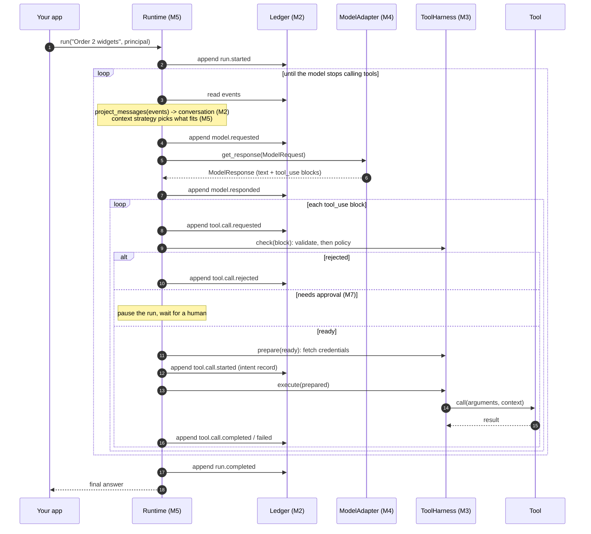

# agentreins internals

How the code works, end to end. For maintainers and contributors: read it to understand, change or extend the core without reverse-engineering it.

| Document | Answers |
|---|---|
| [REQUIREMENTS.md](../REQUIREMENTS.md) | *What* must the framework do? |
| [ARCHITECTURE.md](../../ARCHITECTURE.md) | *Where* does each piece live, and who may import whom? |
| [ADRs](../adr/) | *Why* does each port look the way it does? |
| **This guide** | *How* does the code actually do it? |

## How to read it

Start with the big picture below, then read the pages in order. Each page has the same sections:

1. **What it does**, in two or three sentences.
2. **Diagram** of the main flow.
3. **Files**: which file holds what.
4. **Walkthrough**: one concrete example traced through the code, with line links.
5. **Guarantees**: each promise, and the test that proves it.
6. **Design choices**: what was picked, the alternatives, and what other frameworks do.
7. **Extending it**: how to plug in your own implementation.
8. **Known limits**: what it does not do (yet).

| Page | Area | Built in |
|---|---|---|
| [01 Types](01-types.md) | The shared vocabulary: messages, model calls, tools, events | M1 |
| [02 Storage](02-storage.md) | Ledger, redactor, event stores, projection | M2 |
| [03 Tools](03-tools.md) | `@tool`, tool sources, registry, harness, policy, credentials | M3 |
| 04 Models | Fake and OpenAI-compatible adapters | M4 (to do) |
| 05 Runtime | The agent loop, context, hooks, budgets | M5 (to do) |
| 06 Durability | Recovery, sessions, run keys | M6 (to do) |
| 07 Control | Approvals, rules policy, secrets redactor | M7 (to do) |

Rule: every milestone PR adds or updates its page here (see [CLAUDE.md](../../CLAUDE.md)).

## The big picture: one agent run

The example used throughout: a buyer asks *"Order 2 widgets"*. The model checks stock with a read-only tool, then creates a purchase order with a side-effecting one.



What this shows:

- **The event log is the single source of truth.** Every step is appended to it *before* the next step starts. The conversation sent to the model is rebuilt from the log each turn (`project_messages`), never kept separately.
- **The runtime is the only writer.** The harness and the model adapter return values; only the runtime appends events. That keeps each component testable on its own.
- **`tool.call.started` is written before the tool runs.** If the process crashes in between, the log shows "started, no outcome": recovery (M6) knows a side effect may have happened, and the idempotency key lets the real system ignore a repeat.
- **Every tool call passes the harness.** Validation and policy run for every call, read-only included; there is no other way to run a tool.

### What exists today

| Step | Status |
|---|---|
| Types for everything above | Built (M1) |
| Ledger, redaction, SQLite and in-memory stores, projection | Built (M2) |
| `@tool`, registry, harness, default policy, env credentials | Built (M3) |
| Model adapters (Fake, OpenAI Chat Completions) | M4 |
| The loop itself (`Agent`, `run()`), context strategy, hooks, budgets | M5 |
| Resume after a crash, sessions, run keys in practice | M6 |
| Approvals, rules policy, secrets redactor, `no_governance()` | M7 |

So today the pieces exist and are tested on their own; M5 wires them into the loop above.

## Layers, in one picture

```text
④ adapters   sqlite store · python tools · default policy · env credentials · (models, MCP…)
                 │ implement
② ports       EventStore · Redactor · ToolSource · Policy · CredentialProvider · ModelAdapter …
                 ▲ used by
③ engines     ledger · tools (registry, harness) · context        ③ runtime · session (M5–M6)
                 │ all speak
① types       Message · ContentBlock · ModelRequest/Response · ToolSpec · Event …
```

Engines depend on ports, never on adapters, so any adapter can be swapped. The rule is enforced by [test_architecture.py](../../tests/unit/test_architecture.py).
