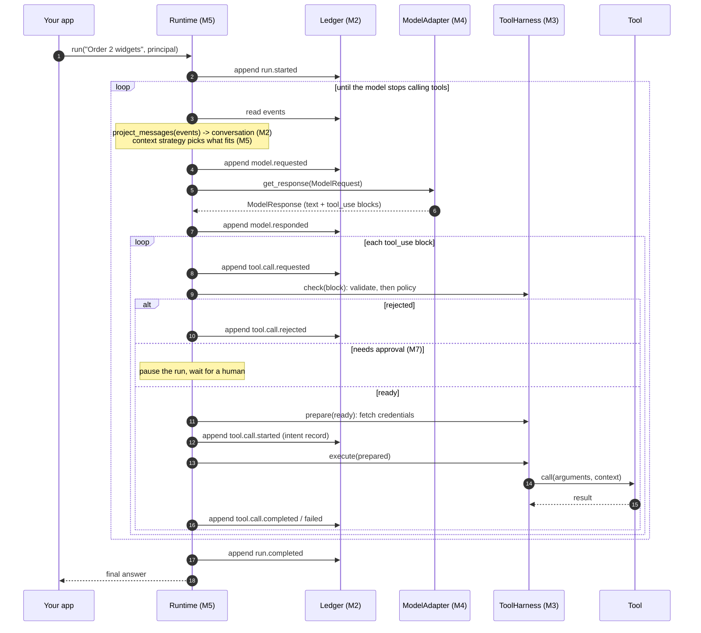

# agentreins internals

How the code works, end to end. For maintainers and contributors: read it to understand, change or extend the core without reverse-engineering it.

| Document | Answers |
|---|---|
| [REQUIREMENTS.md](../REQUIREMENTS.md) | *What* must the framework do? |
| [ARCHITECTURE.md](../../ARCHITECTURE.md) | *Where* does each piece live, and who may import whom? |
| [ADRs](../adr/) | *Why* does each port look the way it does? |
| **This guide** | *How* does the code actually do it? |

## How to read it

This page first explains **how the code is organised** (the pieces), then shows **one agent run** (the pieces working together). Then read the area pages in order. Each has the same sections:

1. **What it does**, in two or three sentences.
2. **Diagram** of the main flow.
3. **Files**: which file holds what.
4. **Walkthrough**: one concrete example traced through the code, with line links.
5. **Guarantees**: each promise, and the test that proves it.
6. **Design choices**: what was picked, the alternatives, and what other frameworks do.
7. **Extending it**: how to plug in your own implementation.
8. **Known limits**: what it does not do (yet).

| Page | Area | Built in |
|---|---|---|
| [01 Types](01-types.md) | The shared vocabulary: messages, model calls, tools, events | M1 |
| [02 Storage](02-storage.md) | Ledger, redactor, event stores, projection | M2 |
| [03 Tools](03-tools.md) | `@tool`, tool sources, registry, harness, policy, credentials | M3 |
| [04 Models](04-models.md) | Fake model, OpenAI-compatible adapter, recorded and live tests | M4 |
| 05 Runtime | The agent loop, context, hooks, budgets | M5 (to do) |
| 06 Durability | Recovery, sessions, run keys | M6 (to do) |
| 07 Control | Approvals, rules policy, secrets redactor | M7 (to do) |

Rule: every milestone PR adds or updates its page here (see [CLAUDE.md](../../CLAUDE.md)).

## How the code is organised

### The picture

Read it top to bottom: your app calls down through the layers. Layer numbers match [ARCHITECTURE.md](../../ARCHITECTURE.md).

```
        your app
           │  calls
 Layer 4   public API      Agent · run() · tool          (M5)
           │  builds the agent, plugs in adapters
 Layer 3   runtime         the loop · sessions           (M5–M6)
           │  uses
 Layer 2   engines         Ledger · ToolHarness · context
           │  calls only the methods listed in
 Layer 1   ports           EventStore · Policy · ToolSource …  (no code)
           ▲  each port is implemented by
           adapters        SQLiteEventStore · DefaultPolicy · @tool …

 Layer 0   types           Message · Event · ToolSpec …
                           (the data every layer passes around)
```

### Each layer in one sentence

| Layer | What it is | Kitchen version | May import |
|---|---|---|---|
| **0 Types** | Data shapes: messages, events, tool specs. No logic. | The ingredients | nothing |
| **1 Ports** | A list of methods with no code: *what* something must be able to do. | A standard socket in the wall | types |
| **2 Engines** | The core logic, written against ports only: the ledger, the tool harness, the context manager. | The cook: follows the recipe with whatever oven is plugged in | types, ports, other engines |
| **3 Runtime** | The agent loop that drives the engines step by step. | The kitchen's order of service | types, ports, engines |
| **4 Public API** | What you import (`Agent`, `tool`). It builds the agent and decides which adapters to plug in. | The restaurant owner who buys the ovens | everything |
| **Adapters** | Real implementations of ports: *how*. Not a layer of their own: they sit beside the core and plug into ports. | The appliances: a Bosch oven, a Miele oven | types, ports |

Two words that are easy to mix up:

- The **ledger** is not a separate kind of thing. It is one of the engines: the one that writes the event log.
- A **port** is not code that runs. It is the *contract* between an engine and an adapter. In Python it is a `Protocol` class: any class with those methods fits, without inheriting from it.

### Following one call through the layers

The runtime wants to save two events. Here is what happens at each layer, with the real code.

**Layer 2, the engine.** The `Ledger` is given *some* store and *some* redactor when it is created, and only ever calls their port methods ([ledger.py:16](../../src/agentreins/ledger/ledger.py#L16)):

```python
class Ledger:
    def __init__(self, store: EventStore, redactor: Redactor) -> None:
        self._store = store
        self._redactor = redactor

    async def append(self, run_id, events, expected_seq):
        redacted = [await self._redact(event) for event in events]
        await self._store.append(run_id, redacted, expected_seq)  # a port method
        return redacted
```

It never imports SQLite and does not know which store it has.

**Layer 1, the port.** `self._store.append(...)` is defined by the `EventStore` port ([event_store.py](../../src/agentreins/ports/event_store.py)), which lists five methods and contains no code:

```python
class EventStore(Protocol):
    async def append(self, run_id: str, events: list[Event], expected_seq: int) -> None: ...
    async def read(self, run_id: str, after_seq: int = -1) -> list[Event]: ...
    async def find_run(self, key: str) -> RunRef | None: ...
    async def list_unfinished(self) -> list[RunRef]: ...
    async def delete_run(self, run_id: str) -> None: ...
```

**The adapter.** Whichever store was plugged in does the actual work. `SQLiteEventStore.append` ([sqlite.py:67](../../src/agentreins/adapters/event_stores/sqlite.py#L67)) opens a transaction, checks for conflicts and flushes to disk. `InMemoryEventStore.append` ([in_memory.py:23](../../src/agentreins/adapters/event_stores/in_memory.py#L23)) appends to a Python list. Same five methods, very different insides.

**Layer 0, the types.** What travels through every step is an `Event` from [events.py](../../src/agentreins/types/events.py): the engine, the port and both adapters all speak it, which is why it sits at the bottom.

### Swapping an adapter

Which adapter is plugged in is decided once, where the agent is built (in M5, by the public API). The engine code never changes:

```python
# production: durable, survives crashes
ledger = Ledger(SQLiteEventStore("agentreins.db"), PassThroughRedactor())

# tests: fast, nothing on disk
ledger = Ledger(InMemoryEventStore(), PassThroughRedactor())
```

The tool harness works the same way, with three ports at once. In the tests ([test_harness.py:91](../../tests/unit/tools/test_harness.py#L91)):

```python
harness = ToolHarness(
    await ToolRegistry.from_sources([PythonToolSource([get_stock, create_po])]),
    DefaultPolicy(),  # Policy port
    EnvCredentialProvider(environ={"AGENTREINS_CRED_ERP": "test-key"}),  # CredentialProvider
)
```

In a company deployment, only the adapters change. These two are examples of adapters a company would write itself:

```python
harness = ToolHarness(
    await ToolRegistry.from_sources([PythonToolSource(my_tools)]),
    CompanyOpaPolicy("https://opa.internal"),  # the company's policy engine
    AwsStsCredentialProvider(role="agent-{principal}"),  # per-user credentials
)
```

To write an adapter of your own, see "Extending it" on each area page; [02 Storage](02-storage.md#extending-it) has a complete example (a redactor that hides email addresses).

### The rule, and why

**Engines may import ports, never adapters. Adapters may import ports and types, never engines.** [test_architecture.py](../../tests/unit/test_architecture.py) fails CI if anyone breaks it. That one rule is what buys:

1. **Swap without touching the core.** Postgres instead of SQLite, a company's policy engine instead of `DefaultPolicy`: write one adapter, and the engines don't change. This is how agentreins fits AWS, IBM or any other platform without depending on any of them.
2. **Tests run offline.** Tests plug in fakes (in-memory store, scripted model) through the same ports. No database, no network, no API key, and the core logic is still fully tested.
3. **A small, stable core.** Engines depend only on ports, so the core needs nothing but pydantic. Heavy dependencies (httpx, Chroma) live in adapters or optional extras.
4. **One promise, checked everywhere.** Each port has contract tests. Whoever writes an adapter, passing them means it is safe to plug in.

This pattern is called **ports and adapters** (or hexagonal architecture). Other frameworks use it for one or two areas: LangGraph's `BaseCheckpointSaver` (port) with `SqliteSaver` and `PostgresSaver` (adapters); the OpenAI Agents SDK's `Model` interface with `OpenAIChatCompletionsModel`. agentreins uses it for all ten extension points.

### All ten ports

| Port | What it decides | Used by | Adapters today | Planned |
|---|---|---|---|---|
| `EventStore` | Where the log is kept | Ledger | `SQLiteEventStore`, `InMemoryEventStore` | Postgres (community) |
| `Redactor` | What is removed before storing | Ledger | `PassThroughRedactor` | Secrets redactor (M7) |
| `ToolSource` | Where tools come from | Tool harness | `PythonToolSource` | MCP (M8) |
| `Policy` | Whether a tool call may run | Tool harness | `DefaultPolicy` | Rules policy (M7) |
| `CredentialProvider` | Which identity reaches a system | Tool harness | `EnvCredentialProvider` (dev only) | Platform plug-ins (STS, OAuth) |
| `ModelAdapter` | Which model provider answers | Runtime | `FakeModel`, `OpenAIChatModel` | Anthropic (M8) |
| `ContextStrategy` | What part of the history the model sees | Context manager | none yet | Keep-all (M5), truncate (M8) |
| `Hooks` | Who gets told about every event | Runtime | none (you write your own) | |
| `Retriever` | Where knowledge is searched | Runtime | none yet | Chroma, in `agentreins[knowledge]` (M8) |
| `MemoryStore` | Where long-term memory lives | Runtime | none yet | In-memory reference (M8) |

Three of these are the governance control points from REQUIREMENTS: `Policy` (what the agent may do), `Redactor` (what is stored and shown to the model) and `CredentialProvider` (which identity reaches data).

## One agent run, end to end

Now the same pieces working together. The example used throughout: a buyer asks *"Order 2 widgets"*. The model checks stock with a read-only tool, then creates a purchase order with a side-effecting one.



What this shows:

- **The event log is the single source of truth.** Every step is appended to it *before* the next step starts. The conversation sent to the model is rebuilt from the log each turn (`project_messages`), never kept separately.
- **The runtime is the only writer.** The harness and the model adapter return values; only the runtime appends events. That keeps each component testable on its own.
- **`tool.call.started` is written before the tool runs.** If the process crashes in between, the log shows "started, no outcome": recovery (M6) knows a side effect may have happened, and the idempotency key lets the real system ignore a repeat.
- **Every tool call passes the harness.** Validation and policy run for every call, read-only included; there is no other way to run a tool.

## What exists today

| Step | Status |
|---|---|
| Types for everything above | Built (M1) |
| Ledger, redaction, SQLite and in-memory stores, projection | Built (M2) |
| `@tool`, registry, harness, default policy, env credentials | Built (M3) |
| Model adapters (Fake, OpenAI Chat Completions) | Built (M4) |
| The loop itself (`Agent`, `run()`), context strategy, hooks, budgets | M5 |
| Resume after a crash, sessions, run keys in practice | M6 |
| Approvals, rules policy, secrets redactor, `no_governance()` | M7 |

So today the engines, ports and first adapters exist and are tested on their own; M5 adds the runtime and public API that wire them into the loop above.
